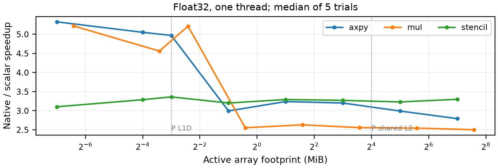
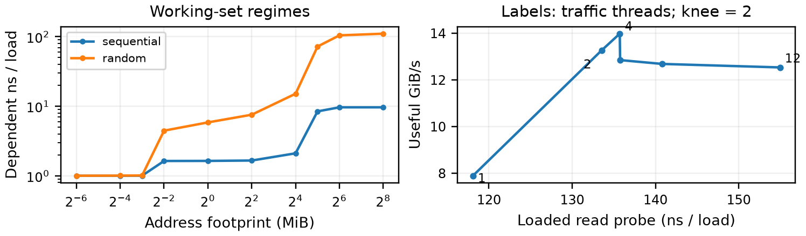
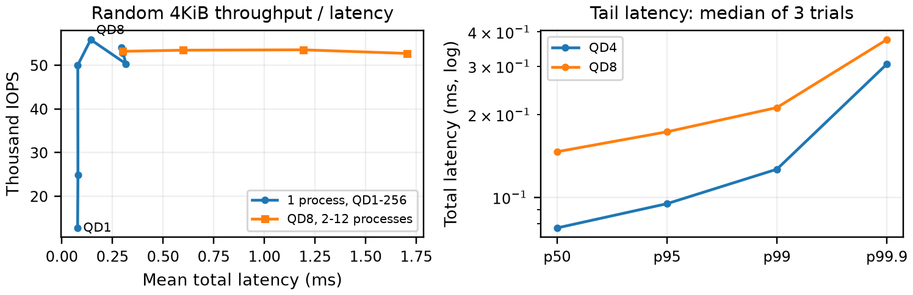

# ECSE 4320/6320 - Class projects

## Project 1 | SIMD advantage

System: M3 Pro (6 P + 6 E cores; 12 physical/logical), 18GB, macOS 15.6.1, Xcode 26.3 / Apple Clang 17.0.0. NEON is 128-bit.

### Hypothesis

Regular float32 loops should gain more than float64; larger footprints, strides and ordered reductions should compress SIMD gains.

### Method

- **AXPY:** y[i] = a*x[i] + y[i].

- **Elementwise multiply:** z[i] = x[i]*y[i].

- **Three-point stencil:** z[i] = a*x[i-1] + b*x[i] + c*x[i+1].

Each kernel was tested with scalar, auto and native builds: -O3 -ffp-contract=off; scalar disables loop/SLP vectors, native adds -mcpu=native; no fast-math/LTO. Initialized 128B-aligned arrays, warmup and reference checks precede ~30ms batches. Five shuffled trials; summary curves show medians and tables report variability; cycles come from real rusage deltas.

Figure 1. Native float32 speedup over scalar versus active array footprint; higher values mean greater SIMD benefit. Gray lines mark P-core L1D (128KiB) and shared L2 (16MiB). Points show five-trial medians; Table 1 gives the corresponding variability.

**Table 1.** Figure 1 speedups: median +/- sample standard deviation (five trials, denominator n-1). Larger SD means more trial-to-trial variation; these are not confidence intervals. Active footprint is 8N bytes for AXPY/stencil and 12N bytes for multiply.

| Elements (N) | AXPY speedup | Multiply speedup | Stencil speedup |
| --- | --- | --- | --- |
| 1,024 | 5.32 +/- 0.132 | 5.22 +/- 0.268 | 3.1 +/- 0.0658 |
| 8,192 | 5.05 +/- 0.048 | 4.56 +/- 0.266 | 3.29 +/- 0.0564 |
| 16,384 | 4.97 +/- 0.152 | 5.21 +/- 0.191 | 3.36 +/- 0.169 |
| 65,536 | 2.99 +/- 0.0854 | 2.55 +/- 0.0759 | 3.2 +/- 0.0705 |
| 262,144 | 3.24 +/- 0.351 | 2.63 +/- 0.0822 | 3.29 +/- 0.139 |
| 1,048,576 | 3.2 +/- 0.483 | 2.56 +/- 0.104 | 3.27 +/- 0.0878 |
| 4,194,304 | 2.99 +/- 0.0982 | 2.54 +/- 0.0404 | 3.23 +/- 0.093 |
| 16,777,216 | 2.79 +/- 0.121 | 2.5 +/- 0.15 | 3.3 +/- 0.197 |

| Native / scalar median speedup | f32, N=1,024 | f32, N=16,777,216 | f64, N=16,777,216 |
| --- | --- | --- | --- |
| axpy | 5.32x | 2.79x | 1.46x |
| mul | 5.22x | 2.50x | 1.32x |
| stencil | 3.10x | 3.30x | 1.67x |

### Interpretation

- **AXPY:** Gains shrink as data movement grows; shifted addresses cost about 10-47% in tested cases.

- **Elementwise multiply:** Gains shrink with size; stride 1 to 8 cuts useful bandwidth from 106 to 10.2GiB/s and native speedup to ~0.99x.

- **Three-point stencil:** Float32 speedup stays near 3.3x, consistent with reuse of neighboring values.

NEON lane counts (4 float32 / 2 float64) do not guarantee equal speedup. N/N+1 effects include scalar tails and loop overhead.

STREAM Copy measured 107.1GB/s; 16 verified register FMAs estimate 122.1GFLOP/s. Float32 arithmetic intensities are AXPY 2/12, multiply 1/12, stencil 5/8 FLOP/B. Roofline measured values are 20.0, 9.1 and 49.0GFLOP/s: memory traffic constrains low-intensity loops. AXPY exceeds the Copy-derived line by ~12%, so it is an approximate traffic-dependent reference.

### Verification

All 1,200 primary rows and 324 boundary checks passed. Compiler remarks/disassembly verify vector width and scalar tails. The compute-ceiling loop contains the expected 16 vector FMAs.

### Negative case

Ordinary dot uses SIMD products but serial additions (~1.00-1.09x); 30 volatile-accumulator controls verify an explicit non-vectorized loop. The incorrect 9-FMA pilot was rejected. Two migrated rows remain included.

Additional required figures: baseline_speedup, baseline_throughput, cycles_per_element, alignment_tail, stride, data_type, roofline (project1/figures/). Detailed numbers and negative-control evidence remain with the project.

## Project 2 | Cache and memory

### Hypothesis

Random dependent loads should slow beyond local caches; concurrency should initially increase bandwidth, then loaded latency. Page spreading should increase translation pressure, with cache conflicts as a confounder.

### Method

- **Dependent-load chase:** Prefaulted, warmed seeded chains sweep footprints, sequential/random patterns and 64/256/1024B spacings.

- **Read/write traffic and probe:** Test 100/0, 0/100, 70/30 and 50/50 mixes and thread counts, using ~256MiB traffic buffers plus a 64MiB read probe.

- **Numeric and page-locality controls:** Compare footprint-related cache misses, page spreading, balanced page offsets and tiny-cycle unrolling.

Native C equivalents of MLC use real cycle counters, ~120ms batches and five trials: 355 primary rows (71 cases x5). Useful throughput counts 8B operations, not bus bytes or store persistence. Pages are 16KiB; cache lines are 128B. P-core L1D/shared L2 are 128KiB/16MiB; E-core equivalents are 64KiB/4MiB. No isolated L3 is exposed.

Figure 2. Left: dependent-load latency versus address footprint; higher latency marks slower observed memory regimes. Right: useful throughput versus loaded-read latency; labels give traffic-thread counts. Points show five-trial medians; Tables 2-3 report the variability of both panels and both axes.

**Table 2.** Figure 2 left: latency in ns/load, median +/- sample SD (five trials).

| Footprint (MiB) | Sequential ns/load | Random ns/load |
| --- | --- | --- |
| 0.015625 | 1 +/- 0.00139 | 1 +/- 0.00477 |
| 0.0625 | 1 +/- 0.0357 | 1.01 +/- 0.00415 |
| 0.125 | 1.01 +/- 0.00592 | 1.01 +/- 0.0112 |
| 0.25 | 1.64 +/- 0.0253 | 4.46 +/- 0.154 |
| 1 | 1.64 +/- 0.0856 | 5.87 +/- 0.0407 |
| 4 | 1.66 +/- 0.0264 | 7.57 +/- 0.0462 |
| 16 | 2.11 +/- 0.0465 | 15.2 +/- 16.5 |
| 32 | 8.45 +/- 0.268 | 72.2 +/- 1.55 |
| 64 | 9.66 +/- 0.103 | 105 +/- 1.51 |
| 256 | 9.66 +/- 0.102 | 110 +/- 2.51 |

**Table 3.** Figure 2 right: median +/- sample SD (five trials). Larger SD means more variation, not a confidence interval.

| Traffic threads | Loaded probe (ns/load) | Useful throughput (GiB/s) |
| --- | --- | --- |
| 1 | 118 +/- 1.32 | 7.89 +/- 0.608 |
| 2 | 134 +/- 0.551 | 13.3 +/- 0.22 |
| 4 | 136 +/- 0.247 | 14 +/- 0.129 |
| 6 | 136 +/- 6.34 | 12.8 +/- 0.677 |
| 8 | 141 +/- 2.9 | 12.7 +/- 0.2 |
| 12 | 155 +/- 6.12 | 12.5 +/- 0.225 |

| Observed random-load regime | Footprint | Median ns/load | Median cycles/load |
| --- | --- | --- | --- |
| P-core-L1-scale | 0.0625MiB | 1.01 | 4.02 |
| L2-scale | 1MiB | 5.87 | 23.53 |
| Beyond local L2 / possible SLC | 32MiB | 72.22 | 290.48 |
| DRAM-scale | 256MiB | 110.48 | 442.35 |

### Interpretation

- **Dependent-load chase:** The table describes observed regimes, not isolated physical-level constants; sequential prefetching can lower latency.

- **Read/write traffic and probe:** Throughput rises from 7.89GiB/s (1 worker) to 13.26 (2) and 13.98 (4), then falls to 12.53 (12). The >=90%-of-maximum knee is 2 workers. Loaded reads rise from ~118 to 154ns; scheduling and E-core use also matter.

- **Pattern and granularity:** With one worker and ~256MiB traffic, sequential read throughput is 7.89, 1.75 and 1.82GiB/s at 64/256/1024B spacing; random reads stay near 1.25-1.30GiB/s. Wider spacing reduces useful data per fetched line, while random access weakens prefetching; index/loop overhead also contributes.

- **Read/write mix:** At 64B sequential spacing, 100/0, 70/30, 50/50 and 0/100 read/write mixes give 7.89, 6.44, 6.27, 6.29GiB/s; loaded-read probes are 118, 131, 141, 178ns/load. Pure reads perform best here; stores can add ownership/writeback traffic, but mixed results are not monotonic and do not measure durable-write latency.

- **Numeric and page-locality controls:** Larger numeric footprints slow with more cache misses. Page-offset balancing helps distinguish translation pressure from cache conflicts.

Little's Law L = lambda W applies to one request population; stream rate times a different probe's latency is only illustrative. AMAT needs per-access probabilities: the chase-only 66/64 instruction-to-load conversion underpredicts the largest case (~43ns vs 110ns), so it is not a validated multilevel model.

### Verification

Cycle uniqueness and read/write references passed. All 42 Instruments captures (3 per case) retain traces/XML and leaf-kernel attribution. Events include L1D load-cache/TLB misses, L2 data-TLB misses, cycles and instructions; misses are normalized per 1,000 sampled instructions. INST_SIMD_ALU also counts scalar FP. Explicit 2MiB superpage allocation failed (invalid argument); no 4KiB/huge-page result is fabricated.

### Negative case

Reusing 64KiB (~9.12GiB/s) is a misleading DRAM test versus 256MiB (~7.89GiB/s); loop overhead also prevents claiming physical peak bandwidth. Page-offset balancing and 63/64-load controls preserve the cache-conflict and tiny-cycle anomalies without inventing an architectural cause.

Other plots: working_set_latency, throughput_latency, granularity_latency, pattern_rw_granularity, hardware_counters, numeric_cache_correlation, page_locality, page_offset_control, cache_reuse_pitfall, tiny_cycle_unroll (project2/figures/). All 33 supplementary timings and failed page-support evidence are retained.

## Project 3 | SSD performance

### Hypothesis

IOPS should plateau and latency rise with concurrency; larger blocks help throughput; buffering may measure RAM.

### Method

- **Pattern, block size and mix:** Test sequential/random reads and writes, six block sizes (4-256KiB) and required read/write mixes; QD1 supplies the baseline.

- **Queue depth and parallelism:** Sweep QD1-256 and 2/4/8/12 forked processes to compare throughput and total I/O latency.

- **Tail latency and range/cache controls:** Record p50/p95/p99/p99.9 and request counts near and below the knee; compare 64/256/1024MiB logical ranges and buffered/direct I/O.

FIO 3.43/posixaio tests an owned 1GiB disposable file on APPLE SSD AP1024Z (~1TB), Apple Fabric/APFS: 16KiB memory alignment, incompressible buffers, direct=1/F_NOCACHE. No raw device was written; completion without per-I/O fsync does not prove NAND persistence. There are 47 cases x3 shuffled trials (141 performance jobs; 147 directional CSV rows) plus 2 preparation jobs. Main jobs use 1s and byte caps.

| QD1 pattern | Mean latency (us) | p95 (us) | p99 (us) |
| --- | --- | --- | --- |
| randread, 4KiB | 78.2 | 90.6 | 138.2 |
| randwrite, 4KiB | 148.5 | 179.2 | 280.6 |
| read, 128KiB | 177.2 | 197.6 | 242.7 |
| write, 128KiB | 40.2 | 50.9 | 79.4 |

Figure 3. Left: random 4KiB throughput versus mean total latency, with queue-depth and process-count sweeps. Right: tail percentiles at QD4/QD8. Points show three-trial medians; Table 4 gives throughput/latency SD and Table 5 gives tail ranges, preserving variability without error bars.

**Table 4.** Figure 3 left: median +/- sample SD (three trials). The QD sweep uses one process; the process-count sweep fixes QD8 per process.

| Configuration | Throughput (thousand IOPS) | Mean total latency (ms) |
| --- | --- | --- |
| QD 1 | 12.7 +/- 0.47 | 0.0782 +/- 0.00302 |
| QD 2 | 24.9 +/- 3.52 | 0.0798 +/- 0.00914 |
| QD 4 | 50 +/- 6.68 | 0.0792 +/- 0.00915 |
| QD 8 | 55.9 +/- 3.16 | 0.143 +/- 0.00759 |
| QD 16 | 50.3 +/- 6.32 | 0.317 +/- 0.0472 |
| QD 32 | 54.1 +/- 3.02 | 0.295 +/- 0.0177 |
| QD 64 | 53.1 +/- 0.0528 | 0.3 +/- 0.000296 |
| QD 128 | 53 +/- 6.78 | 0.301 +/- 0.0327 |
| QD 256 | 52.8 +/- 3.65 | 0.302 +/- 0.0195 |
| Processes 2 | 53.2 +/- 0.272 | 0.3 +/- 0.0015 |
| Processes 4 | 53.4 +/- 0.0646 | 0.598 +/- 0.000733 |
| Processes 8 | 53.5 +/- 0.183 | 1.19 +/- 0.004 |
| Processes 12 | 52.7 +/- 0.227 | 1.71 +/- 0.00743 |

### Interpretation

- **Pattern and block size:** At QD1, 4 to 256KiB raises sequential-read throughput from 183 to 928MiB/s and random reads from 49.8 to 909MiB/s. The sequential/random gap narrows as larger transfers amortize request overhead; random-read mean latency rises from 78.2 to 274.4us, so higher MiB/s does not imply lower latency or higher IOPS. Sequential/random writes rise from 224/26.2 to 3587/3436MiB/s; these are burst completion rates, not durable NAND-write rates.

- **Read/write mix:** Random 4KiB, QD16, with 0/100, 50/50, 70/30 and 100/0 read/write mixes yields 23.3, 32.0, 37.7, 50.3 thousand IOPS and 685, 498, 423, 317us mean total latency. More reads help this measured device state; the trend is not a universal SSD rule. Highest individual read rates were 64,952 random IOPS and 3,955MiB/s sequential; no numerical Apple Fabric/PCIe ceiling is inferred.

- **Queue depth and parallelism:** The single-process >=90%-of-maximum knee is QD8 (~55.9k median IOPS). Forked processes reach ~90 in-flight requests yet stay near 53k IOPS as mean latency rises to ~1.71ms. L = IOPS x mean total latency describes the application population, not controller occupancy.

- **Tail latency and range/cache controls:** Table 5 retains the median and full trial range of every tail percentile; warmed buffered reads can inflate apparent SSD performance. Logical file ranges do not reveal physical APFS LBAs.

Temperatures were 28-39C. Existing-state burst tests do not establish steady state, SLC exhaustion or thermal throttling.

**Table 5.** Figure 3 right: median [minimum, maximum] in us, across three trials per configuration. Ranges describe observed trials, not confidence intervals.

| Read-only tail run | p50 (us) | p95 (us) | p99 (us) | p99.9 (us) |
| --- | --- | --- | --- | --- |
| tail-mid-q4 | 77.3 [77.3, 77.3] | 94.7 [93.7, 95.7] | 126.5 [123.4, 130.6] | 305.2 [257.0, 7372.8] |
| tail-near_knee-q8 | 146.4 [146.4, 148.5] | 173.1 [173.1, 177.2] | 212.0 [205.8, 222.2] | 374.8 [358.4, 432.1] |

### Verification

Separate 64MiB CRC32C write/read validation passed; no I/O errors. Payload writes were 53.375GiB (<104GiB cap). All six read-only tail jobs completed >=123,209 requests (~123 expected beyond p99.9); all four percentiles and counts are retained. Total/completion latency differ; directional percentiles are not averaged. The ~7.37ms p99.9 outlier remains; scheduling/background I/O or device management are plausible, not proven GC.

### Negative case

Requested QD32-256 produces only ~16 average in-flight requests, so requested depth is misleading. Warmed buffered reads strongly inflate apparent SSD IOPS; the direct-I/O comparison exposes the page-cache effect.

Complete plots, FIO configs, JSON+ histograms, temperatures and write ledger: project3/.
