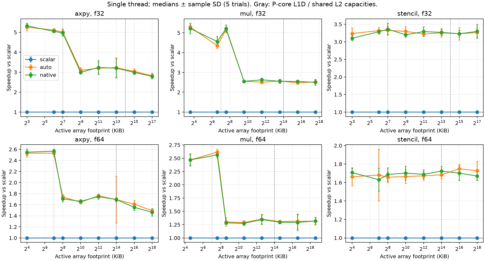
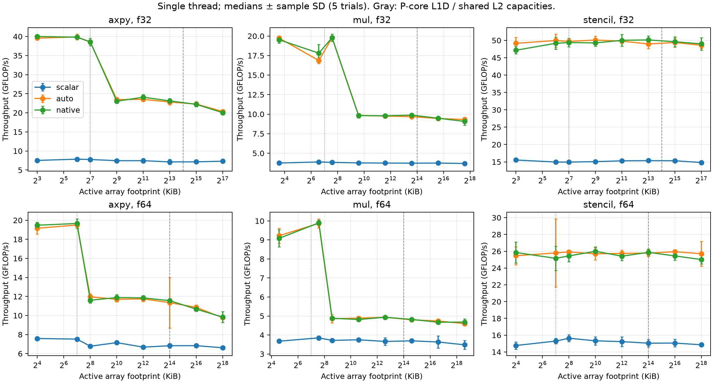
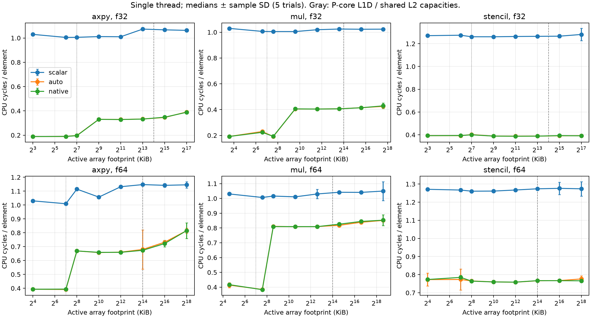
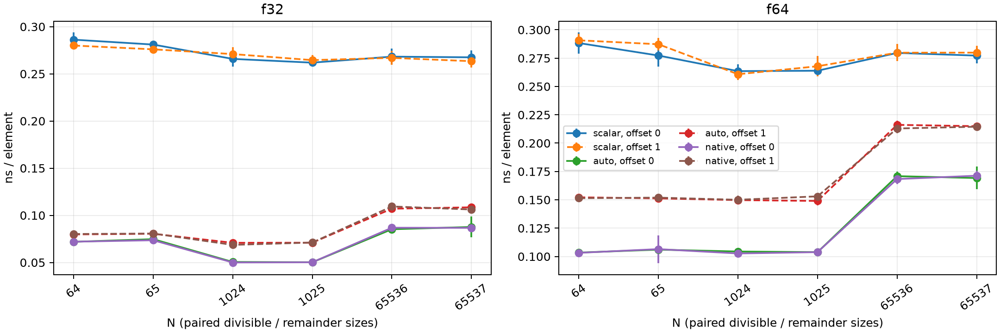
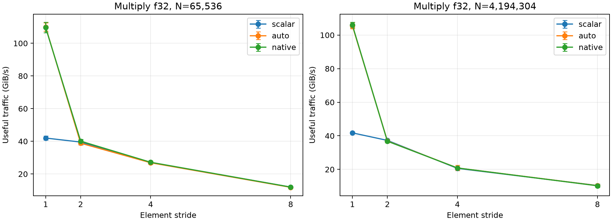
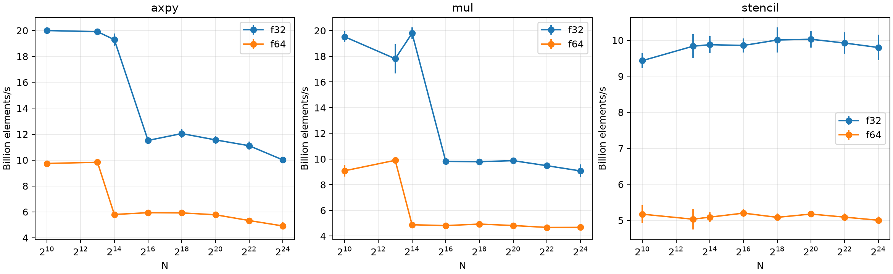
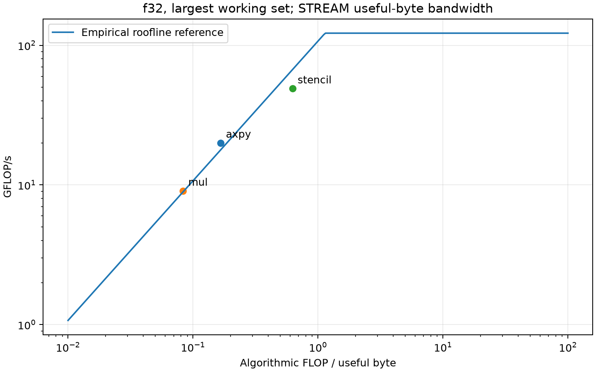

# Project 1 — SIMD Advantage Profiling


## Scope and method


Three required kernels: AXPY, multiply, three-point stencil. Strict dot product is an extra negative case. All required kernels are single-threaded.

Apple M3 Pro (6 P + 6 E cores), 18GB, macOS 15.6.1; Apple Clang 17.0.0. Exact build commands and environment are retained under evidence/ and data/raw/.

`-O3 -ffp-contract=off` is common to all builds. Scalar adds `-fno-vectorize -fno-slp-vectorize`; native adds `-mcpu=native`. No fast-math and no LTO.

Timing uses CLOCK_MONOTONIC_RAW around an adaptively calibrated ~30ms batch after warm-up. Allocation, initialization, reference checks, and checksums are outside timing.

Separate kernel translation units prevent repeated-call elimination. Arrays are 128-byte aligned before the documented element offset. Deterministic finite dyadic inputs are used.

The process ri_cycles / ri_instructions counters bracket each batch; they include small counter/clock/call overhead. Cycles are NOT converted from a guessed frequency.

User-initiated QoS requests a performance preference but does not pin a core. Dynamic frequency and background OS activity remain; all trials, including migrated runs, are retained.

Five independently ordered trials per configuration; plots show median ± sample SD. Speedup is the scalar time divided by the matching build time within each trial.


## Correctness and vectorization


All 1,200 measured invocations passed reference checks before timing. Counter availability: True.

Reference implementations compute expected finite results independently in the driver; AXPY output is reset after calibration. Remainders and shifted addresses are explicitly exercised.

See evidence/*-vectorization.txt and the concise excerpts below; full disassembly is retained as supporting evidence, not pasted into the report.

```
/Users/hanliu/Desktop/Hanpei/RPI Class/ecse6320acs/project1/src/kernels.c:19:1: remark: vectorized loop (vectorization width: 4, interleaved count: 4) [-Rpass=loop-vectorize]
/Users/hanliu/Desktop/Hanpei/RPI Class/ecse6320acs/project1/src/kernels.c:20:1: remark: vectorized loop (vectorization width: 2, interleaved count: 4) [-Rpass=loop-vectorize]
```

The vector width is 128 bits: 4 float32 or 2 float64 lanes. Default and CPU-targeted builds need not have different widths on this machine. Main kernels disable FMA contraction, and scalar tail instructions remain.


## Cache locality, throughput, and cycles








The vertical markers show the P-core 128KiB L1D and shared 16MiB L2, not inferred extra cache capacities. E cores have different capacities, and Apple system-level cache is not labeled as a measured L3.

| kernel | dtype | n | speedup | gflops | gib_per_s |
| --- | --- | --- | --- | --- | --- |
| axpy | f32 | 1024 | 5.3239 | 39.995 | 223.49 |
| axpy | f32 | 16777216 | 2.7914 | 20.026 | 111.91 |
| axpy | f64 | 1024 | 2.5481 | 19.479 | 217.69 |
| axpy | f64 | 16777216 | 1.4621 | 9.8331 | 109.89 |
| mul | f32 | 1024 | 5.2161 | 19.523 | 218.18 |
| mul | f32 | 16777216 | 2.5015 | 9.071 | 101.38 |
| mul | f64 | 1024 | 2.4691 | 9.0855 | 203.08 |
| mul | f64 | 16777216 | 1.3194 | 4.6774 | 104.55 |
| stencil | f32 | 1024 | 3.1023 | 47.17 | 70.289 |
| stencil | f32 | 16777216 | 3.2976 | 48.998 | 73.012 |
| stencil | f64 | 1024 | 1.7084 | 25.851 | 77.041 |
| stencil | f64 | 16777216 | 1.6707 | 25.009 | 74.531 |

At N=1024, native float32 AXPY reaches about 5.3× scalar; at N=16,777,216 it falls to about 2.8×. Float64 multiply falls from about 2.5× to 1.3×. These changes support compressed SIMD benefit as data movement grows, though cache-resident scalar dependency/throughput limits also matter.

The largest active footprints extend well beyond local CPU caches. Algorithmic GiB/s counts useful array traffic, not observed DRAM bus transactions; write allocation and prefetching can add physical traffic.


## Alignment, remainders, stride, and precision








Offset 1 means 4 bytes for float32 and 8 bytes for float64. N/N+1 pairs distinguish a vector-width remainder, but small-loop call/prologue/epilogue overhead also contributes; these plots do not isolate a single instruction latency.

| dtype | n | aligned_ns_element | shifted_ns_element | shifted_over_aligned |
| --- | --- | --- | --- | --- |
| f32 | 64 | 0.072034 | 0.080175 | 1.113 |
| f32 | 65 | 0.073586 | 0.080685 | 1.0965 |
| f32 | 1024 | 0.050006 | 0.068662 | 1.3731 |
| f32 | 1025 | 0.050193 | 0.071142 | 1.4174 |
| f32 | 65536 | 0.086824 | 0.10938 | 1.2598 |
| f32 | 65537 | 0.0867 | 0.10618 | 1.2247 |
| f64 | 64 | 0.10322 | 0.15145 | 1.4673 |
| f64 | 65 | 0.1065 | 0.15193 | 1.4266 |
| f64 | 1024 | 0.10268 | 0.15003 | 1.4612 |
| f64 | 1025 | 0.10384 | 0.15306 | 1.474 |
| f64 | 65536 | 0.16833 | 0.21292 | 1.2649 |
| f64 | 65537 | 0.17125 | 0.2145 | 1.2526 |

The aligned/shifted ratios above quantify the observed combined cost; paired N/N+1 points show remainder sensitivity. Their differences cannot be assigned solely to an unaligned instruction, because prologue, epilogue, scalar tails and clock noise also change.

| n | stride | gib_per_s | speedup |
| --- | --- | --- | --- |
| 65536 | 1 | 109.66 | 2.5532 |
| 65536 | 2 | 40.109 | 1.0169 |
| 65536 | 4 | 27.164 | 1.0091 |
| 65536 | 8 | 11.978 | 1.0013 |
| 4194304 | 1 | 105.95 | 2.5438 |
| 4194304 | 2 | 36.768 | 0.99461 |
| 4194304 | 4 | 20.862 | 1.0196 |
| 4194304 | 8 | 10.233 | 0.9858 |

Non-unit stride spends more cache-line traffic on unused elements and can require scalar or gathered/strided code. Equal N in the type plot means float64 also doubles the active byte footprint.


## Roofline interpretation


The median STREAM Copy reference is 107.10 GB/s of useful bytes. The validated register-FMA microbenchmark estimates a 122.12 GFLOP/s single-thread compute ceiling.

The largest float32 AXPY measurement exceeds the STREAM-derived line by about 12%; this is evidence that the chosen Copy bandwidth is not a universal traffic-matched bound. Stencil is below that line and has higher arithmetic intensity. These are empirical reference ceilings under this run policy, not a vendor-guaranteed physical peak. STREAM Copy uses different read/write traffic from each kernel; the line is an approximate interpretation, not a strict universal upper bound.

The first compute pilot was rejected because disassembly contained only 9 of the assumed 16 FMAs. Rejected data and the reason are retained in evidence/rejected-peak-pilot/. The accepted loop must contain 16 FMAs.

FLOP counts: AXPY 2/element, multiply 1/element, stencil 5/interior element. Useful traffic: 12, 12, and 8 bytes respectively in float32; stencil assumes spatial reuse of neighboring inputs.




| kernel | dtype | arithmetic_intensity | measured_gflops | bound_gflops | bandwidth_bytes_s | compute_ceiling_gflops |
| --- | --- | --- | --- | --- | --- | --- |
| axpy | f32 | 0.16667 | 20.026 | 17.85 | 1.071e+11 | 122.12 |
| mul | f32 | 0.083333 | 9.071 | 8.925 | 1.071e+11 | 122.12 |
| stencil | f32 | 0.625 | 48.998 | 66.938 | 1.071e+11 | 122.12 |


## Negative case and anomalies


The original strict dot hypothesis was partly falsified: Clang vectorizes products (fmul.4s / fmul.2d), then extracts lanes and accumulates with serial scalar fadd to preserve order. Native speedup is only about 1.00–1.09×. It is incorrect to call this loop wholly unvectorized or to attribute its bottleneck solely to DRAM bandwidth. See data/processed/negative_case.csv and the dot function disassembly.

A separate explicit no-vectorization control uses a volatile float32 accumulator. This adds observable per-iteration loads/stores and deliberately constrains optimization; it is not proposed as efficient code. Both inputs, sizes, flags, trial counts and reference results are retained. The native compiler reports a volatile read and cannot vectorize the loop; targeted disassembly verifies no vector arithmetic in observable_dot.

| n | auto | native | scalar | auto_speedup | native_speedup |
| --- | --- | --- | --- | --- | --- |
| 1024 | 2.655 | 2.5872 | 2.66 | 1.0019 | 1.0281 |
| 1048576 | 2.6743 | 2.6472 | 2.6898 | 1.0058 | 1.0161 |

See evidence/negative-*-vectorization.txt, negative-verification.json and data/raw/negative/. The table gives median ns/element for each build plus scalar/optimized ratios; five trials per case. Changing optimization flags cannot remove the observable-access dependency.

2 / 1200 rows have less than 90% P-core cycles. No such row was silently removed. The minimum thread-CPU/wall ratio was 0.939; scheduling/frequency effects contribute to variability.

Cache-resident speedups need not equal the number of lanes, because scalar pipelining, instruction-level parallelism, loop overhead, and memory traffic all matter. Working-set growth may compress gains without invalidating the presence of SIMD.


## Reproduction and deliverables


See README.md, HYPOTHESES.md, AI_USE.md, config/plan.json, data/raw/, data/processed/, figures/, and evidence/. All plots are regenerated by this script. A GitHub destination is still a submission step, not evidence that these measurements were uploaded.
