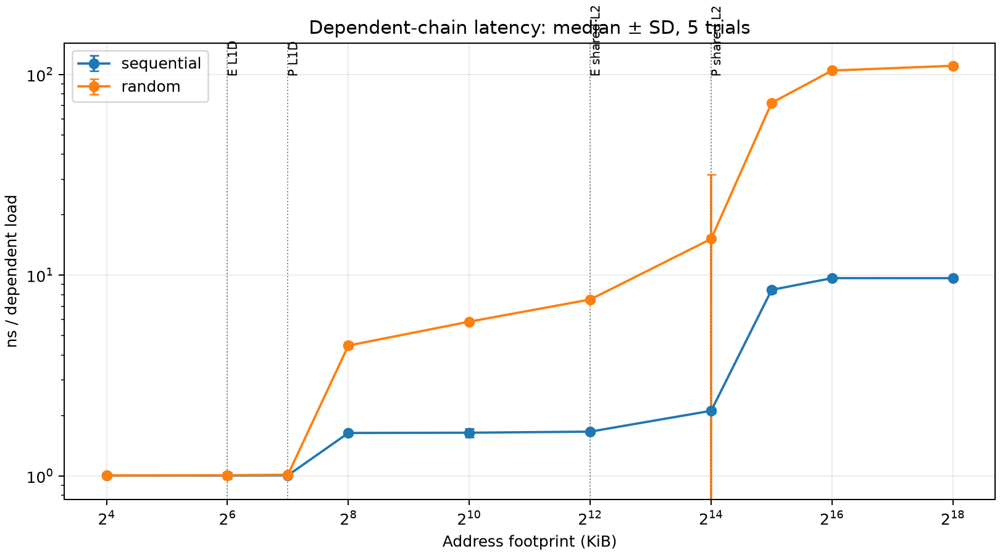
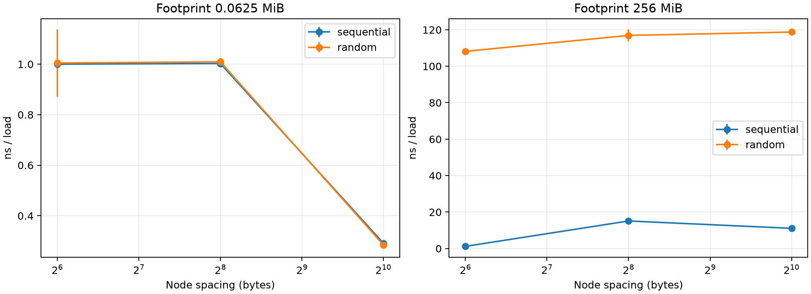
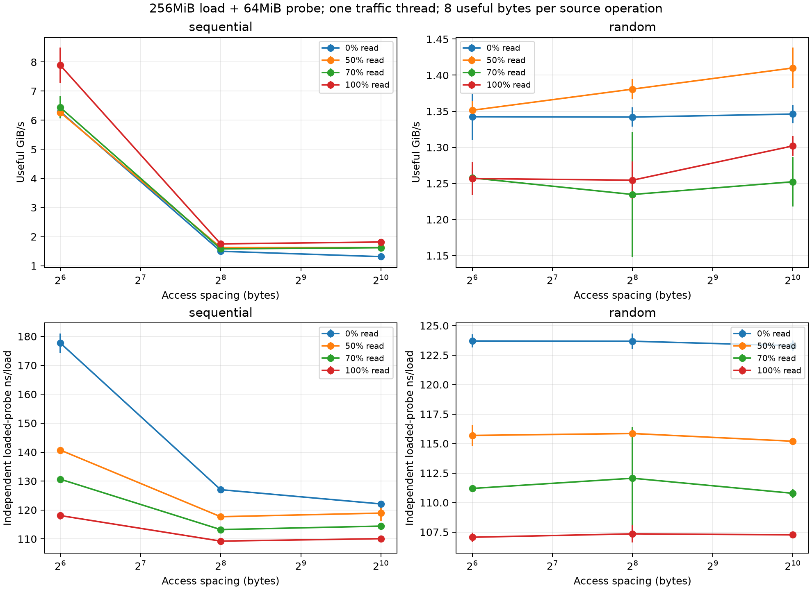
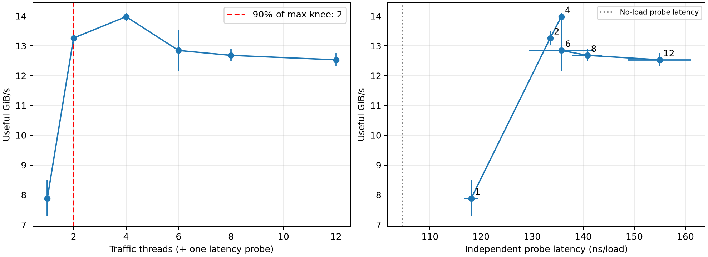
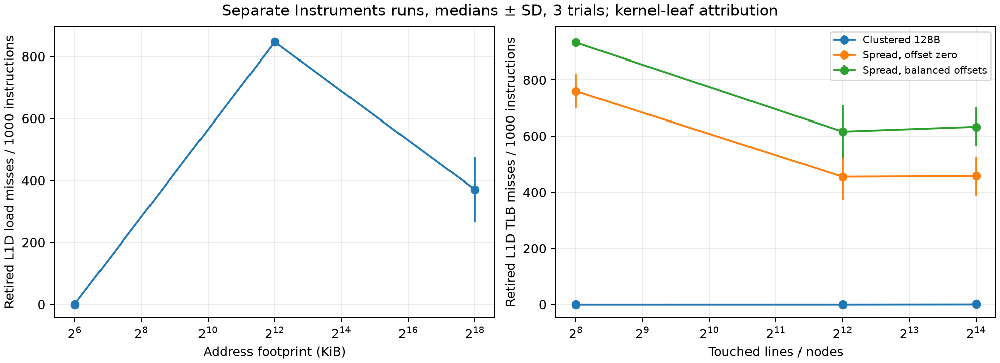
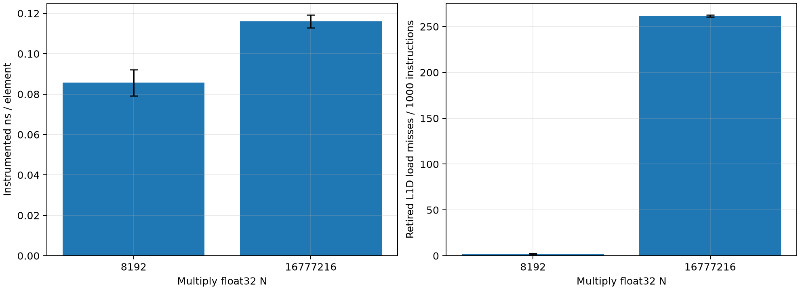
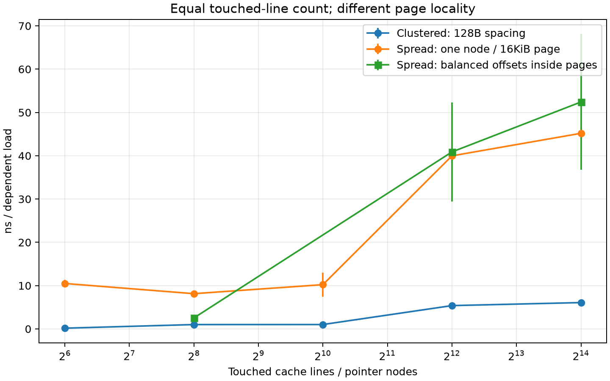
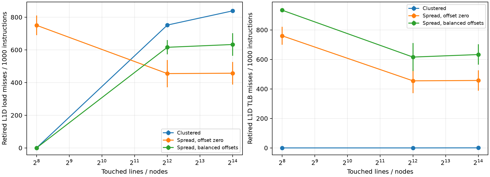
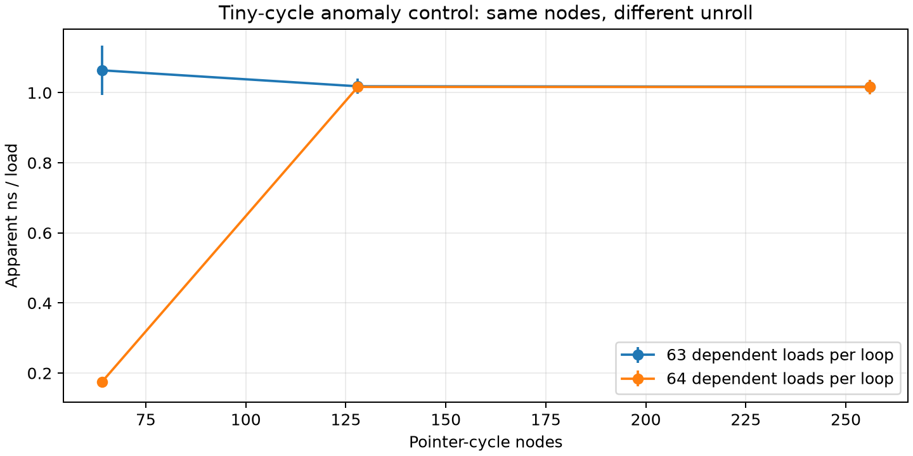
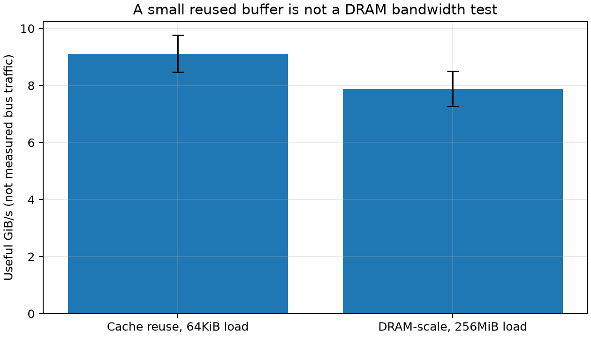

# Project 2 — Cache & Memory Performance Profiling

## Method and controls

Native C benchmarks replace Intel MLC, which is not a native Apple Silicon/macOS tool. Exact code, commands, trial seeds, and pre-experiment hypotheses are included.

M3 Pro, 18GB unified memory, macOS 15.6.1, Apple Clang 17.0.0; 128B cache line and 16KiB native pages. P cores: 128KiB L1D and 16MiB shared L2; E cores: 64KiB L1D and 4MiB shared L2.

No fixed-frequency governor, strict pinning, CPU isolation, or NUMA placement is claimed. User-initiated QoS is a hint. Power state and system snapshots are retained before/after each project.

Pointer chains contain all selected nodes in one cycle, with sequential or seeded Fisher–Yates random order. A dependent 64-load unrolled chain approximates low-queue latency. All pages are initialized and the chain is warmed before timing.

Traffic buffers total approximately 256MiB, partitioned across workers. A separate 64MiB random pointer chain measures read latency under load. Timer checks are amortized over load batches; clocks are CLOCK_MONOTONIC_RAW.

Read/write percentages describe source-level 8-byte operations. Writes may trigger read-for-ownership and writeback; useful GiB/s is not measured DRAM bus traffic. Random traffic also reads a precomputed index array, whose size is recorded.

Self-tests validate unique cycles and every read/write mix against a sequential small reference. Five trials per plain configuration are retained; figures show median ± sample SD.

## Low-queue baselines and cache transitions

| region | footprint_bytes | median_ns | std_ns | median_cycles |
| --- | --- | --- | --- | --- |
| P-core-L1-scale | 65536 | 1.0078 | 0.0041469 | 4.022 |
| L2-scale | 1048576 | 5.8654 | 0.040722 | 23.527 |
| Beyond local L2 / possible SLC | 33554432 | 72.22 | 1.5486 | 290.48 |
| DRAM-scale | 268435456 | 110.48 | 2.5107 | 442.35 |

These are observed working-set regimes, not isolated physical-level latency constants. No separately exposed L3 was found; the beyond-L2 region may also include Apple system-level cache. The largest range is 256MiB.

Sequential pointer chains can be prefetched. A tiny 64-node randomized cycle produced an unusually low apparent latency; it is retained as an anomaly and excluded from the per-level baseline table. See any supplementary unroll study before assigning a microarchitectural cause.

## Patterns, read/write mix, and access intensity

The first tested traffic-thread count reaching 90% of the maximum median useful throughput is 2. The no-load probe median is 104.56ns/load. The knee definition is operational and does not prove a device-only saturation threshold.

Loaded latency is the independent read-probe latency, including scheduling interference. It is not the completion or persistence latency of individual store operations. Adding threads can also use E cores; pinning limitations prevent attributing every change solely to DRAM queuing.

Little’s Law is L = lambda W for the same request population in a stable interval. A single dependent DRAM-scale chain has about one request available at a time; its reciprocal latency explains why it cannot reach streaming bandwidth.

For the 100%-read, 64B-spaced stream, two useful 8B accesses can share one 128B line. An illustrative line-demand rate is useful_bytes_per_second / 16, assuming one fetch per line and no extra reuse. Multiplying this by the independent probe latency gives only an approximate concurrency requirement; it is NOT an observed outstanding-request count because probe and stream latencies are different populations.

## Cache and TLB counter correlation

The saved Instruments manual template selects retired L1D load-cache misses, retired L1D TLB misses, L2 data-TLB misses, cycles, instructions, and SIMD/FP arithmetic instructions. Original traces, raw XML, event definitions, exact commands, and executable hashes are preserved.

A byte-identical executable is staged to a temporary path without spaces for reliable xctrace launching. The initial launch from a spaced path stalled and was rejected as a pilot.

Only counter samples whose leaf PC is in chase_batch or mul_f32 are attributed to that kernel. This includes warm-up calls, excludes allocation/driver samples, and is sampled-delta attribution rather than exact whole-process perf-stat totals. Three separate instrumented trials per profile avoid mixing instrumentation overhead into the plain-time sweep.

Miss counts are normalized per 1000 retired instructions. L2_TLB_MISS_DATA has different speculative/retirement semantics from the NONSPEC L1 event; their numerical counts are not assumed to nest.

AMAT = L1_hit_time + L1_miss_rate * lower_level_penalty is the interpretation model. Misses per instruction are NOT a miss probability per memory access, so that raw denominator cannot directly supply the AMAT probability. The measured latency and counter trends jointly support the locality interpretation.

For the dependent chase only, disassembly verifies 64 loads plus SUBS and B.NE per unrolled loop. Multiplying misses/instruction by 66/64 approximates misses/load, ignoring small bookend/sampling attribution overhead. The following AMAT illustration uses L1 and lower-regime latency endpoints for calibration; it is not an independent predictive validation, and a detailed multilevel model would need L2-cache hit/miss probabilities.

| footprint_bytes | approx_L1_miss_probability | assumed_lower_penalty_ns | illustrative_AMAT_ns | observed_plain_ns |
| --- | --- | --- | --- | --- |
| 65536 | 2.5067e-05 | 4.8576 | 1.0079 | 1.0078 |
| 4194304 | 0.87308 | 4.8576 | 5.2489 | 7.5659 |
| 268435456 | 0.38204 | 109.47 | 42.829 | 110.48 |

The two-endpoint AMAT estimate substantially underpredicts the largest case (about 43ns vs 110ns). The counted retired L1 event, sampled instruction attribution, prefetch/speculation and mixed lower-level hit paths do not form a complete probability tree. The discrepancy is retained; it prevents claiming a validated multilevel AMAT model from these counters.

## Page locality and huge pages

Clustered and spread variants touch the same number of distinct cache lines. Spread uses one node per 16KiB page; clustered uses 128B spacing. Both cache conflicts and translation pressure can matter, hence the hardware TLB events above are needed rather than treating elapsed time as a TLB count.

The initial spread case used page offset zero for every node, which can also alias L1 sets. An adaptive control distributes offsets as ((node_index * 17) mod 128) * 128 bytes inside each page. It preserves node/page count while balancing the obvious index bits. Both original and controlled data are retained; residual physical coloring and lower-cache effects are not assumed absent.

The tiny-cycle control changes only the unroll factor (63 versus 64 dependent loads) at 64/128/256 nodes. It is a benchmark-structure check, not a separate cache-capacity measurement; no unsupported microarchitectural mechanism is claimed.

The native page size is 16384 bytes. An explicit 2MiB superpage request returned 4: (os/kern) invalid argument. The PDF allows huge pages where available; no huge-page result is fabricated. Native 4KiB pages are not a selectable equivalent on this host.

## Misleading benchmark and limitations

| label | median_useful_GiB_s | std |
| --- | --- | --- |
| Cache reuse, 64KiB load | 9.1172 | 0.64514 |
| DRAM-scale, 256MiB load | 7.8863 | 0.6085 |

The cache-resident and DRAM-scale buffers use the same traffic loop and independent probe. Calling both measurements “DRAM bandwidth” would be misleading. The experimental kernel also includes per-operation control overhead and cannot establish a hardware peak bandwidth by itself.

Unexpected high tails or small-iteration effects are retained, not hidden. Hardware thermal/frequency state, OS interference, prefetching, shared caches, and index-generation traffic limit causal attribution.

## Deliverables

README.md provides build/run/analysis commands. HYPOTHESES.md predates results. AI_USE.md distinguishes agent validation from the student’s required independent review. Plans, raw records, processed tables, plots, PMU evidence and the failed superpage probe are included.
