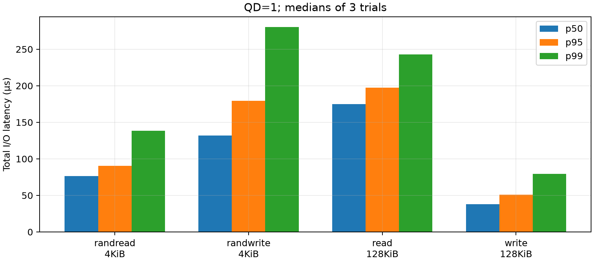
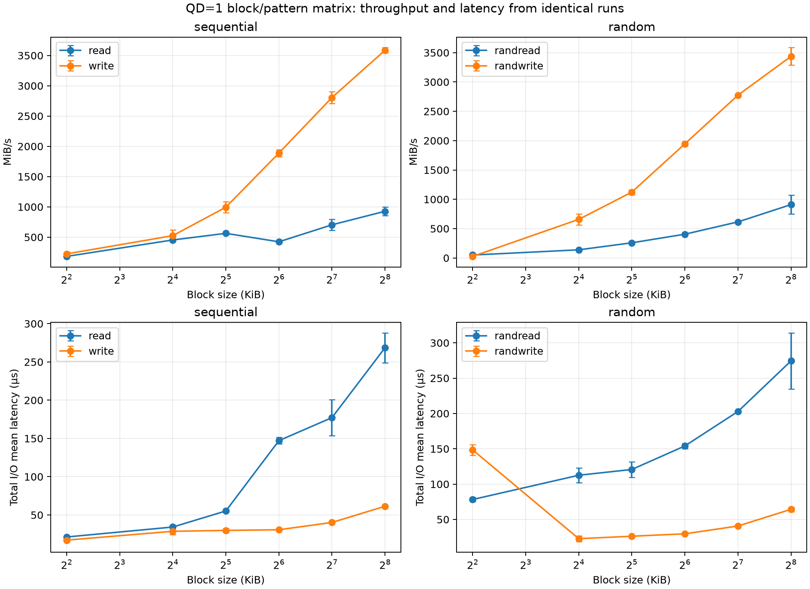
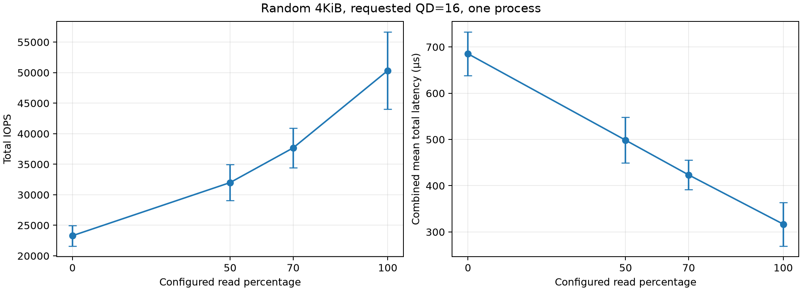
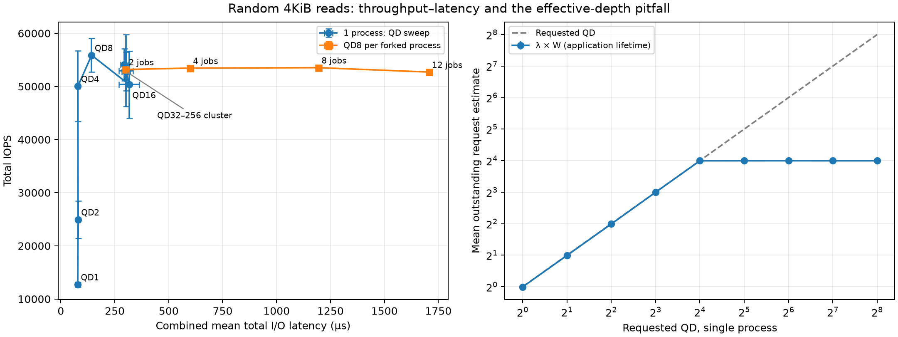
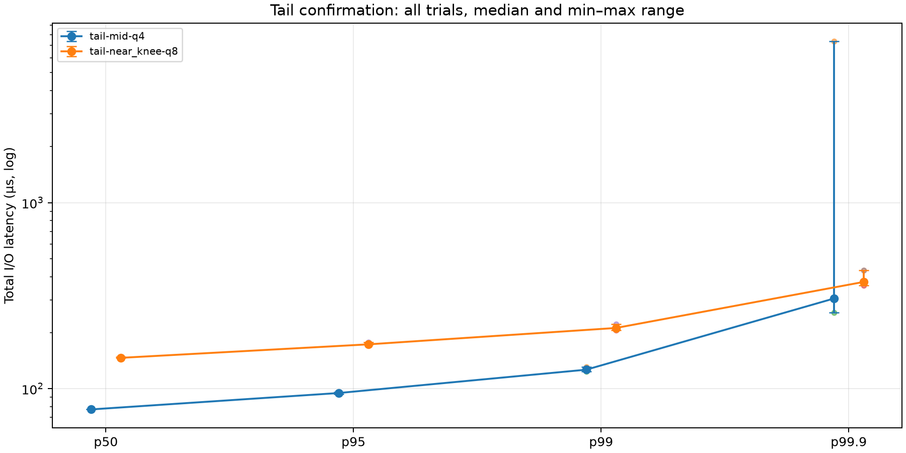
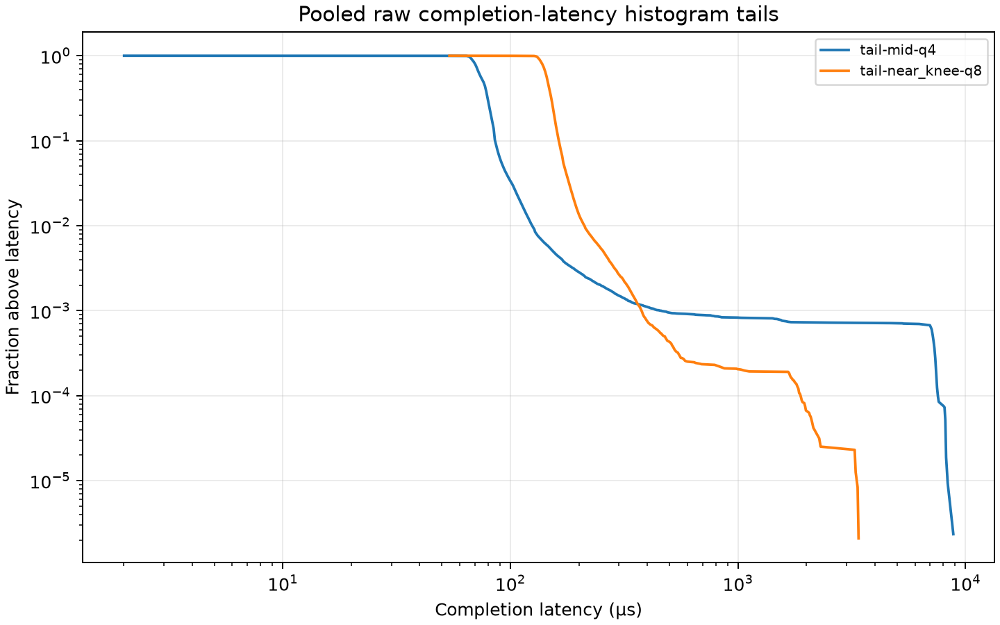
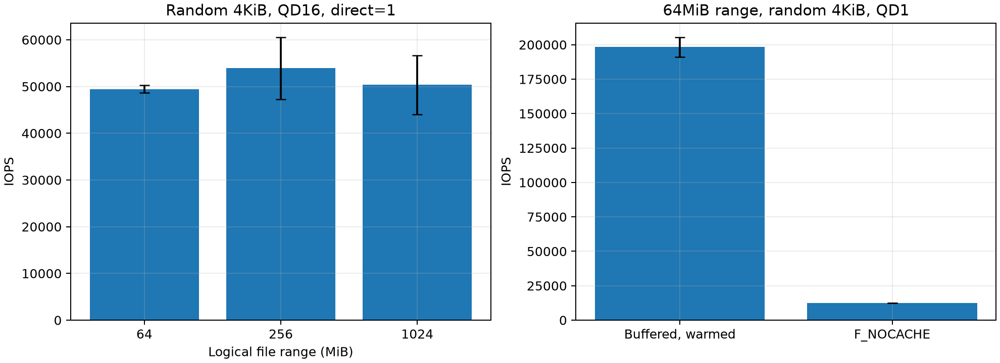

# Project 3 — SSD Performance Profiling

## Safe scope and method

APPLE SSD AP1024Z, approximately 1TB, internal Apple Fabric/NVMe controller, APFS on macOS 15.6.1, M3 Pro CPU. Native block size reported by diskutil: 4096B. Exact system and tool versions are retained in environment records.

All writes target only project3/work/ssd-test.bin or verify.bin, newly created under an ownership marker. Raw device writes and arbitrary file paths are not accepted. The data file is 1GiB; no partition was changed.

FIO 3.43, posixaio; primary runs use direct=1, implemented by F_NOCACHE on macOS, and 16KiB memory alignment. This is a filesystem-level measurement, not a raw flash or standard PCIe-lane benchmark.

A separate 64MiB CRC32C write/read verification passed before the data-file initialization. The main file was fully written with incompressible buffers and flushed once before the matrix.

refill_buffers=1 and buffer_compress_percentage=0 are held fixed. This adds CPU work, so observed maxima include FIO, OS, and filesystem overhead. Random seeds and every generated .fio configuration are retained.

Each matrix run is bounded by 1s and an I/O-byte cap (2GiB for write/mixed, 4GiB for read), whichever finishes first. No time-based unlimited writes or uncounted ramp writes are used. Three shuffled trials per case expose variability.

Actual test writes including initialization/CRC verification: 53.375GiB, below the 104GiB enforced budget. The shortest block-matrix run lasted 570ms; these are controlled burst/current-state tests, not steady-state certification.

Primary write latency is FIO completion latency with page-cache bypass; no per-I/O fsync is used. Completion is NOT claimed to prove NAND persistence. Total lat_ns includes submission and completion; clat_ns is separately retained.

## QD=1 baselines

| rw | bs | io_count | mean_latency_us | p50_us | p95_us | p99_us |
| --- | --- | --- | --- | --- | --- | --- |
| randread | 4096 | 12751 | 78.214 | 76.288 | 90.624 | 138.24 |
| randwrite | 4096 | 6712 | 148.49 | 132.1 | 179.2 | 280.58 |
| read | 131072 | 5638 | 177.19 | 175.1 | 197.63 | 242.69 |
| write | 131072 | 16384 | 40.211 | 38.144 | 50.944 | 79.36 |

The table reports medians of trial percentiles, not a percentile of pooled requests. Each raw JSON+ retains latency histograms and counts. QD=1 limits this application to one outstanding I/O, not all system/background device traffic.

## Block size, pattern, and read/write mix

| read_percent | iops | bandwidth_mib_s | combined_mean_latency_ns |
| --- | --- | --- | --- |
| 0 | 23302 | 91.022 | 6.853e+05 |
| 50 | 31998 | 124.99 | 4.9842e+05 |
| 70 | 37676 | 147.17 | 4.2337e+05 |
| 100 | 50334 | 196.62 | 3.1692e+05 |

Block-matrix throughput and latency come from the same runs at fixed QD=1. The mix comparison uses random 4KiB at QD16, including pure-read and pure-write endpoints. Mixed latency is weighted by completion count; read/write percentiles remain separate rather than being averaged together.

## Throughput–latency knee and actual concurrency

The single-process operational knee is the smallest tested QD reaching 90% of that curve’s maximum median IOPS: QD8. This definition includes measurement uncertainty and does not establish a raw hardware saturation knee.

Requested QD32–256 did not produce those effective depths: lambda × mean total latency stayed near 16. The raw iodepth_level distributions corroborate the engine/OS limitation. Treating requested QD256 as achieved hardware QD256 would be misleading.

A read-only follow-up uses 2, 4, 8 and 12 forked FIO processes, each at QD8 and with disjoint aligned portions of the same aggregate 1GiB file range. Threads in a single process would not test beyond a per-process limit. Its exact adaptive plan is saved separately.

Forked-process medians remain approximately 53k IOPS as estimated concurrency increases from 16 to 90 and latency grows from 300 to 1,706µs. This supports a plateau in the measured host/filesystem workload; it does not isolate flash-controller limits. Merely adding processes makes response time worse here.

Little’s Law: L=lambda W. Here lambda is the same job group’s completion IOPS and W its count-weighted mean total latency in seconds. The estimate refers to application request lifetime; it is not a direct measurement of the SSD controller’s NVMe queue occupancy. Finite run boundaries and submission overhead cause small deviations.

The highest individual observed random-read rate was 64,952 IOPS; the highest observed sequential read throughput was 3,955.0MiB/s. These are observed host-stack results, not a proven device specification or an interface ceiling.

The controller is exposed as Apple Fabric, without a standard public PCIe link-width/speed ceiling in the collected metadata. We therefore do not invent a numerical PCIe ceiling. Controller parallelism, OS AIO limits, filesystem work, CPU overhead and finite test range all bound the observation.

## Tail latency, range, and device state

Longer read-only confirmations at mid QD and near the single-process knee each completed at least 123,209 requests per trial. The p99.9 tail therefore has at least about 123 observations beyond its cutoff; this is more credible than tiny tests but not a confidence guarantee.

All three tail trials are plotted, including the large outlier; whiskers show the observed min–max range. JSON+ histograms are pooled only for the completion-latency survival plot, which is explicitly different from total-latency percentile plots.

The largest trial p99.9 was 7,372.8µs. A transient OS scheduling/background-I/O or device-management event is plausible; the available evidence does not isolate garbage collection as the cause. It is retained, not discarded.

The range sweep uses 64MiB, 256MiB and 1GiB logical file ranges. APFS physical placement is not controlled, so these are not known contiguous LBA spans. Buffered 64MiB reads are explicitly warmed before the intentional page-cache pitfall.

Read-only SMART snapshots before/after each run recorded 28–39°C. No claim of thermal throttling follows from temperature alone. Unsupported NVMe error-log retrieval is avoided by requesting only supported health/attribute logs.

The drive was in its existing used state, not fresh or secure-erased. Full-device preconditioning and deliberate SLC-cache exhaustion are omitted to honor the small, bounded study. Burst vs sustained effects are discussed as limitations; unobserved steady state is not presented as measured.

## Reproduction and deliverables

See README.md, HYPOTHESES.md, AI_USE.md, config/generated/*.fio, all plans, raw JSON+/metadata, the write ledger, processed CSVs and plotting code. All required percentiles and sample counts are retained; no failing I/O result is silently accepted.
